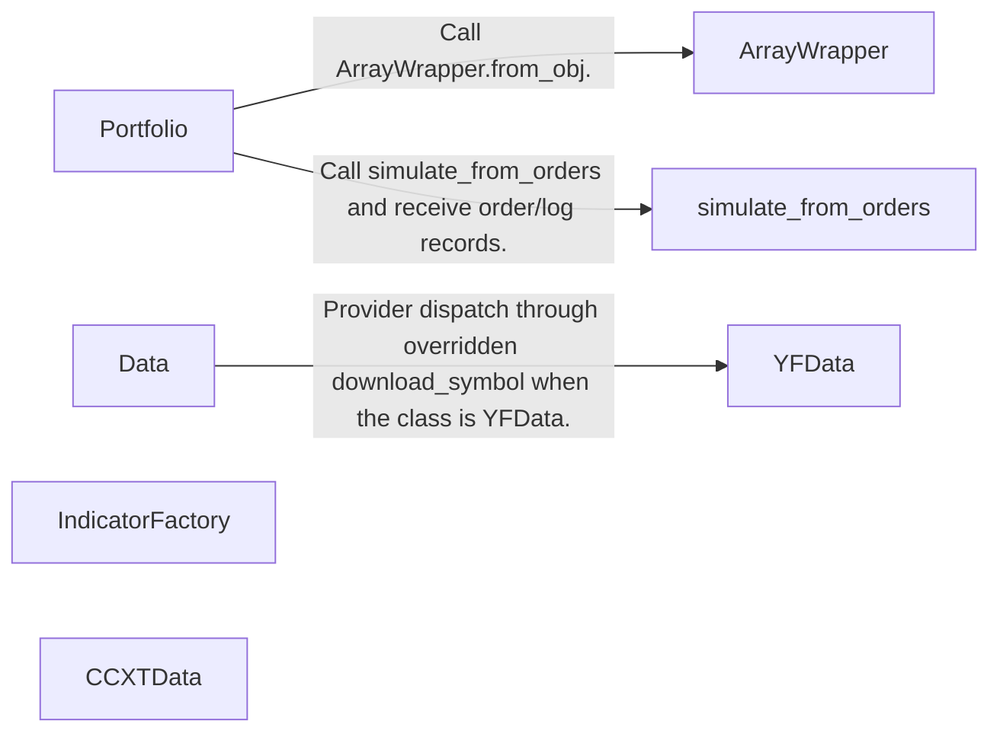
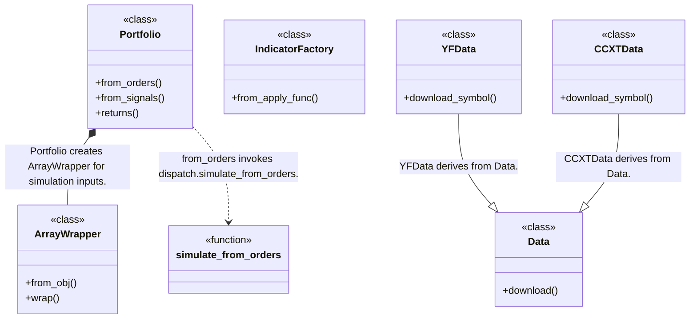
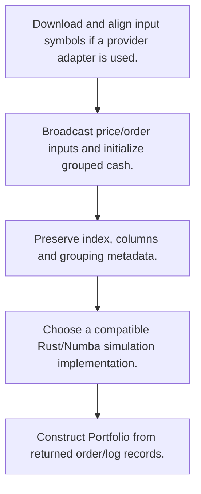
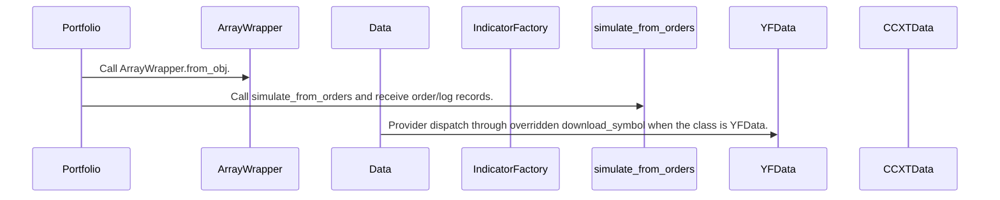

# vectorbt: workflow, design and architecture

Updated: **2026-10-13**
Reviewed Git hash: `586d2a85a4e4a73a9174fb8973d5869dab4d89ce`
Branch: `feature/ayu_develop`
Source diff SHA256: `e3b0c44298fc1c149afbf4c8996fb92427ae41e4649b934ca495991b7852b855`
Scope: **Array-oriented portfolio research toolkit** / Maintenance: **active**
Languages: Python, Rust

[HTML edition](ayu-develop.html) / [Development](development.md) / [Historical validation](validation.md) / [Full system comparison](../../docs/index.html)

## Purpose and scope

Broadcast price/order/signal arrays, run portfolio simulations, retain pandas labels and calculate performance.

## Features and support boundaries

Native = implemented here. Integration = supplied through a named host/API. Limited = material restriction. Not provided = evidenced scope exclusion. Unverified = support/absence not established. Not applicable = outside this artifact type.

| Capability | Status | Implementation and limits | Source |
|---|---|---|---|
| Backtesting | Native | Portfolio simulations accept broadcast orders and signals. | [Portfolio.from_orders](../src/vectorbt/portfolio/base.py) ([L1624](https://github.com/alexcwyu/vectorbt/blob/586d2a85a4e4a73a9174fb8973d5869dab4d89ce/src/vectorbt/portfolio/base.py#L1624)) / [Portfolio.from_signals](../src/vectorbt/portfolio/base.py) ([L2055](https://github.com/alexcwyu/vectorbt/blob/586d2a85a4e4a73a9174fb8973d5869dab4d89ce/src/vectorbt/portfolio/base.py#L2055)) |
| Live execution | Unverified | The inspected source does not establish this capability. This is not a claim of absence. | Not applicable to this repository scope. |
| Paper trading | Unverified | The inspected source does not establish this capability. This is not a claim of absence. | Not applicable to this repository scope. |
| Event driven | Limited | Ordered simulation callbacks exist, but this flow is array-oriented rather than a live event bus. | [Portfolio.from_orders](../src/vectorbt/portfolio/base.py) ([L1624](https://github.com/alexcwyu/vectorbt/blob/586d2a85a4e4a73a9174fb8973d5869dab4d89ce/src/vectorbt/portfolio/base.py#L1624)) / [Portfolio.from_signals](../src/vectorbt/portfolio/base.py) ([L2055](https://github.com/alexcwyu/vectorbt/blob/586d2a85a4e4a73a9174fb8973d5869dab4d89ce/src/vectorbt/portfolio/base.py#L2055)) |
| Vectorized | Native | Broadcasts arrays across columns/groups for portfolio research. | [Portfolio.from_orders](../src/vectorbt/portfolio/base.py) ([L1624](https://github.com/alexcwyu/vectorbt/blob/586d2a85a4e4a73a9174fb8973d5869dab4d89ce/src/vectorbt/portfolio/base.py#L1624)) / [Portfolio.from_signals](../src/vectorbt/portfolio/base.py) ([L2055](https://github.com/alexcwyu/vectorbt/blob/586d2a85a4e4a73a9174fb8973d5869dab4d89ce/src/vectorbt/portfolio/base.py#L2055)) / [ArrayWrapper.from_obj](../src/vectorbt/base/array_wrapper.py) ([L358](https://github.com/alexcwyu/vectorbt/blob/586d2a85a4e4a73a9174fb8973d5869dab4d89ce/src/vectorbt/base/array_wrapper.py#L358)) / [ArrayWrapper.wrap](../src/vectorbt/base/array_wrapper.py) ([L535](https://github.com/alexcwyu/vectorbt/blob/586d2a85a4e4a73a9174fb8973d5869dab4d89ce/src/vectorbt/base/array_wrapper.py#L535)) |
| Order management | Limited | Simulated order/log records and cash constraints. No external order acknowledgement lifecycle. | [Portfolio.from_orders](../src/vectorbt/portfolio/base.py) ([L1624](https://github.com/alexcwyu/vectorbt/blob/586d2a85a4e4a73a9174fb8973d5869dab4d89ce/src/vectorbt/portfolio/base.py#L1624)) / [Portfolio.from_signals](../src/vectorbt/portfolio/base.py) ([L2055](https://github.com/alexcwyu/vectorbt/blob/586d2a85a4e4a73a9174fb8973d5869dab4d89ce/src/vectorbt/portfolio/base.py#L2055)) / [simulate_from_orders](../src/vectorbt/portfolio/dispatch.py) ([L537](https://github.com/alexcwyu/vectorbt/blob/586d2a85a4e4a73a9174fb8973d5869dab4d89ce/src/vectorbt/portfolio/dispatch.py#L537)) |
| Order types | Limited | Order amount/direction/price parameters and signal SL/TP/trailing behavior are simulation semantics. | [Portfolio.from_orders](../src/vectorbt/portfolio/base.py) ([L1624](https://github.com/alexcwyu/vectorbt/blob/586d2a85a4e4a73a9174fb8973d5869dab4d89ce/src/vectorbt/portfolio/base.py#L1624)) / [Portfolio.from_signals](../src/vectorbt/portfolio/base.py) ([L2055](https://github.com/alexcwyu/vectorbt/blob/586d2a85a4e4a73a9174fb8973d5869dab4d89ce/src/vectorbt/portfolio/base.py#L2055)) |
| Multi venue | Integration | CCXTData supports externally selected exchanges for historical OHLCV. Cross-venue execution is not established. | [CCXTData.download_symbol](../src/vectorbt/data/custom.py) ([L612](https://github.com/alexcwyu/vectorbt/blob/586d2a85a4e4a73a9174fb8973d5869dab4d89ce/src/vectorbt/data/custom.py#L612)) |
| Crypto | Integration | CCXT fetchOHLCV data integration. This does not provide crypto live execution. | [CCXTData.download_symbol](../src/vectorbt/data/custom.py) ([L612](https://github.com/alexcwyu/vectorbt/blob/586d2a85a4e4a73a9174fb8973d5869dab4d89ce/src/vectorbt/data/custom.py#L612)) |
| Equities | Integration | Yahoo ticker history integration. Market execution rules are not enforced by provider adapters. | [YFData.download_symbol](../src/vectorbt/data/custom.py) ([L260](https://github.com/alexcwyu/vectorbt/blob/586d2a85a4e4a73a9174fb8973d5869dab4d89ce/src/vectorbt/data/custom.py#L260)) |
| Futures | Unverified | The inspected source does not establish this capability. This is not a claim of absence. | Not applicable to this repository scope. |
| Options | Unverified | The inspected source does not establish this capability. This is not a claim of absence. | Not applicable to this repository scope. |
| Forex | Unverified | The inspected source does not establish this capability. This is not a claim of absence. | Not applicable to this repository scope. |
| Strategy api | Native | Order/signal constructors and generated indicator functions. | [Portfolio.from_orders](../src/vectorbt/portfolio/base.py) ([L1624](https://github.com/alexcwyu/vectorbt/blob/586d2a85a4e4a73a9174fb8973d5869dab4d89ce/src/vectorbt/portfolio/base.py#L1624)) / [Portfolio.from_signals](../src/vectorbt/portfolio/base.py) ([L2055](https://github.com/alexcwyu/vectorbt/blob/586d2a85a4e4a73a9174fb8973d5869dab4d89ce/src/vectorbt/portfolio/base.py#L2055)) / [IndicatorFactory.from_apply_func](../src/vectorbt/indicators/factory.py) ([L3135](https://github.com/alexcwyu/vectorbt/blob/586d2a85a4e4a73a9174fb8973d5869dab4d89ce/src/vectorbt/indicators/factory.py#L3135)) |
| Optimization | Limited | Indicator factories generate parameter combinations. Parameter sweep is not proof of an optimizer solving an objective. | [IndicatorFactory.from_apply_func](../src/vectorbt/indicators/factory.py) ([L3135](https://github.com/alexcwyu/vectorbt/blob/586d2a85a4e4a73a9174fb8973d5869dab4d89ce/src/vectorbt/indicators/factory.py#L3135)) |
| Machine learning | Unverified | The inspected source does not establish this capability. This is not a claim of absence. | Not applicable to this repository scope. |
| Reinforcement learning | Unverified | The inspected source does not establish this capability. This is not a claim of absence. | Not applicable to this repository scope. |
| Portfolio | Native | Grouping and optional cash sharing plus order records. | [Portfolio.from_orders](../src/vectorbt/portfolio/base.py) ([L1624](https://github.com/alexcwyu/vectorbt/blob/586d2a85a4e4a73a9174fb8973d5869dab4d89ce/src/vectorbt/portfolio/base.py#L1624)) / [Portfolio.from_signals](../src/vectorbt/portfolio/base.py) ([L2055](https://github.com/alexcwyu/vectorbt/blob/586d2a85a4e4a73a9174fb8973d5869dab4d89ce/src/vectorbt/portfolio/base.py#L2055)) |
| Risk management | Native | Cash constraints, SL/TP and partial/rejected order simulation. | [Portfolio.from_orders](../src/vectorbt/portfolio/base.py) ([L1624](https://github.com/alexcwyu/vectorbt/blob/586d2a85a4e4a73a9174fb8973d5869dab4d89ce/src/vectorbt/portfolio/base.py#L1624)) / [Portfolio.from_signals](../src/vectorbt/portfolio/base.py) ([L2055](https://github.com/alexcwyu/vectorbt/blob/586d2a85a4e4a73a9174fb8973d5869dab4d89ce/src/vectorbt/portfolio/base.py#L2055)) |
| Performance analytics | Native | Portfolio.returns derives per-column/group returns from portfolio value and initial cash through backend dispatch. | [Portfolio.returns](../src/vectorbt/portfolio/base.py) ([L4634](https://github.com/alexcwyu/vectorbt/blob/586d2a85a4e4a73a9174fb8973d5869dab4d89ce/src/vectorbt/portfolio/base.py#L4634)) |
| Historical data | Integration | Provider neutral Data.download plus Yahoo and CCXT adapters. | [Data.download](../src/vectorbt/data/base.py) ([L562](https://github.com/alexcwyu/vectorbt/blob/586d2a85a4e4a73a9174fb8973d5869dab4d89ce/src/vectorbt/data/base.py#L562)) / [YFData.download_symbol](../src/vectorbt/data/custom.py) ([L260](https://github.com/alexcwyu/vectorbt/blob/586d2a85a4e4a73a9174fb8973d5869dab4d89ce/src/vectorbt/data/custom.py#L260)) / [CCXTData.download_symbol](../src/vectorbt/data/custom.py) ([L612](https://github.com/alexcwyu/vectorbt/blob/586d2a85a4e4a73a9174fb8973d5869dab4d89ce/src/vectorbt/data/custom.py#L612)) |
| Streaming data | Unverified | The inspected source does not establish this capability. This is not a claim of absence. | Not applicable to this repository scope. |
| Persistence | Unverified | The inspected source does not establish this capability. This is not a claim of absence. | Not applicable to this repository scope. |
| Data pipeline | Native | Symbol downloads and aligned data converted to labelled arrays. | [ArrayWrapper.from_obj](../src/vectorbt/base/array_wrapper.py) ([L358](https://github.com/alexcwyu/vectorbt/blob/586d2a85a4e4a73a9174fb8973d5869dab4d89ce/src/vectorbt/base/array_wrapper.py#L358)) / [ArrayWrapper.wrap](../src/vectorbt/base/array_wrapper.py) ([L535](https://github.com/alexcwyu/vectorbt/blob/586d2a85a4e4a73a9174fb8973d5869dab4d89ce/src/vectorbt/base/array_wrapper.py#L535)) / [Data.download](../src/vectorbt/data/base.py) ([L562](https://github.com/alexcwyu/vectorbt/blob/586d2a85a4e4a73a9174fb8973d5869dab4d89ce/src/vectorbt/data/base.py#L562)) |
| Web ui | Unverified | The inspected source does not establish this capability. This is not a claim of absence. | Not applicable to this repository scope. |
| Cli | Unverified | The inspected source does not establish this capability. This is not a claim of absence. | Not applicable to this repository scope. |
| Monitoring | Unverified | The inspected source does not establish this capability. This is not a claim of absence. | Not applicable to this repository scope. |
| Extension api | Native | IndicatorFactory wraps user apply functions and Data subclasses override providers. | [Data.download](../src/vectorbt/data/base.py) ([L562](https://github.com/alexcwyu/vectorbt/blob/586d2a85a4e4a73a9174fb8973d5869dab4d89ce/src/vectorbt/data/base.py#L562)) / [IndicatorFactory.from_apply_func](../src/vectorbt/indicators/factory.py) ([L3135](https://github.com/alexcwyu/vectorbt/blob/586d2a85a4e4a73a9174fb8973d5869dab4d89ce/src/vectorbt/indicators/factory.py#L3135)) |
| Native acceleration | Native | Current checkout dispatches compatible portfolio arrays to Rust, otherwise Numba paths according to engine selection. | [simulate_from_orders](../src/vectorbt/portfolio/dispatch.py) ([L537](https://github.com/alexcwyu/vectorbt/blob/586d2a85a4e4a73a9174fb8973d5869dab4d89ce/src/vectorbt/portfolio/dispatch.py#L537)) |
| Distributed execution | Unverified | The inspected source does not establish this capability. This is not a claim of absence. | Not applicable to this repository scope. |

## System components

| Component | Responsibility | Source |
|---|---|---|
| Portfolio | Portfolio simulation and result facade. | [Portfolio.from_orders](../src/vectorbt/portfolio/base.py) ([L1624](https://github.com/alexcwyu/vectorbt/blob/586d2a85a4e4a73a9174fb8973d5869dab4d89ce/src/vectorbt/portfolio/base.py#L1624)) / [Portfolio.from_signals](../src/vectorbt/portfolio/base.py) ([L2055](https://github.com/alexcwyu/vectorbt/blob/586d2a85a4e4a73a9174fb8973d5869dab4d89ce/src/vectorbt/portfolio/base.py#L2055)) / [Portfolio.returns](../src/vectorbt/portfolio/base.py) ([L4634](https://github.com/alexcwyu/vectorbt/blob/586d2a85a4e4a73a9174fb8973d5869dab4d89ce/src/vectorbt/portfolio/base.py#L4634)) |
| ArrayWrapper | Pandas metadata and grouped array wrapping. | [ArrayWrapper.from_obj](../src/vectorbt/base/array_wrapper.py) ([L358](https://github.com/alexcwyu/vectorbt/blob/586d2a85a4e4a73a9174fb8973d5869dab4d89ce/src/vectorbt/base/array_wrapper.py#L358)) / [ArrayWrapper.wrap](../src/vectorbt/base/array_wrapper.py) ([L535](https://github.com/alexcwyu/vectorbt/blob/586d2a85a4e4a73a9174fb8973d5869dab4d89ce/src/vectorbt/base/array_wrapper.py#L535)) |
| Data | Provider-neutral symbol data collection. | [Data.download](../src/vectorbt/data/base.py) ([L562](https://github.com/alexcwyu/vectorbt/blob/586d2a85a4e4a73a9174fb8973d5869dab4d89ce/src/vectorbt/data/base.py#L562)) |
| IndicatorFactory | Custom indicator and parameter combinator generation. | [IndicatorFactory.from_apply_func](../src/vectorbt/indicators/factory.py) ([L3135](https://github.com/alexcwyu/vectorbt/blob/586d2a85a4e4a73a9174fb8973d5869dab4d89ce/src/vectorbt/indicators/factory.py#L3135)) |
| simulate_from_orders | Backend-neutral portfolio dispatch. | [simulate_from_orders](../src/vectorbt/portfolio/dispatch.py) ([L537](https://github.com/alexcwyu/vectorbt/blob/586d2a85a4e4a73a9174fb8973d5869dab4d89ce/src/vectorbt/portfolio/dispatch.py#L537)) |
| YFData | Yahoo Finance history integration. | [YFData.download_symbol](../src/vectorbt/data/custom.py) ([L260](https://github.com/alexcwyu/vectorbt/blob/586d2a85a4e4a73a9174fb8973d5869dab4d89ce/src/vectorbt/data/custom.py#L260)) |
| CCXTData | CCXT crypto OHLCV integration. | [CCXTData.download_symbol](../src/vectorbt/data/custom.py) ([L612](https://github.com/alexcwyu/vectorbt/blob/586d2a85a4e4a73a9174fb8973d5869dab4d89ce/src/vectorbt/data/custom.py#L612)) |

## Architecture and component boundaries

The component view summarizes inspected responsibility boundaries. Arrows identify the documented API/data dependencies; this is not a deployment-readiness claim.

- Call ArrayWrapper.from_obj.: [Portfolio.from_orders](../src/vectorbt/portfolio/base.py) ([L1624](https://github.com/alexcwyu/vectorbt/blob/586d2a85a4e4a73a9174fb8973d5869dab4d89ce/src/vectorbt/portfolio/base.py#L1624)) / [Portfolio.from_signals](../src/vectorbt/portfolio/base.py) ([L2055](https://github.com/alexcwyu/vectorbt/blob/586d2a85a4e4a73a9174fb8973d5869dab4d89ce/src/vectorbt/portfolio/base.py#L2055))
- Call simulate_from_orders and receive order/log records.: [Portfolio.from_orders](../src/vectorbt/portfolio/base.py) ([L1624](https://github.com/alexcwyu/vectorbt/blob/586d2a85a4e4a73a9174fb8973d5869dab4d89ce/src/vectorbt/portfolio/base.py#L1624)) / [Portfolio.from_signals](../src/vectorbt/portfolio/base.py) ([L2055](https://github.com/alexcwyu/vectorbt/blob/586d2a85a4e4a73a9174fb8973d5869dab4d89ce/src/vectorbt/portfolio/base.py#L2055))
- Provider dispatch through overridden download_symbol when the class is YFData.: [Data.download](../src/vectorbt/data/base.py) ([L562](https://github.com/alexcwyu/vectorbt/blob/586d2a85a4e4a73a9174fb8973d5869dab4d89ce/src/vectorbt/data/base.py#L562)) / [YFData.download_symbol](../src/vectorbt/data/custom.py) ([L260](https://github.com/alexcwyu/vectorbt/blob/586d2a85a4e4a73a9174fb8973d5869dab4d89ce/src/vectorbt/data/custom.py#L260))

## Design decisions

| Decision | Rationale | Tradeoff | Evidence |
|---|---|---|---|
| Keep array computations separate from pandas metadata. | Broadcasting and wrappers support parameter and asset comparisons with labelled outputs. | A shape or dtype unsupported by Rust can require another engine path. | [Portfolio.from_orders](../src/vectorbt/portfolio/base.py) ([L1624](https://github.com/alexcwyu/vectorbt/blob/586d2a85a4e4a73a9174fb8973d5869dab4d89ce/src/vectorbt/portfolio/base.py#L1624)) / [Portfolio.from_signals](../src/vectorbt/portfolio/base.py) ([L2055](https://github.com/alexcwyu/vectorbt/blob/586d2a85a4e4a73a9174fb8973d5869dab4d89ce/src/vectorbt/portfolio/base.py#L2055)) / [ArrayWrapper.from_obj](../src/vectorbt/base/array_wrapper.py) ([L358](https://github.com/alexcwyu/vectorbt/blob/586d2a85a4e4a73a9174fb8973d5869dab4d89ce/src/vectorbt/base/array_wrapper.py#L358)) / [ArrayWrapper.wrap](../src/vectorbt/base/array_wrapper.py) ([L535](https://github.com/alexcwyu/vectorbt/blob/586d2a85a4e4a73a9174fb8973d5869dab4d89ce/src/vectorbt/base/array_wrapper.py#L535)) / [simulate_from_orders](../src/vectorbt/portfolio/dispatch.py) ([L537](https://github.com/alexcwyu/vectorbt/blob/586d2a85a4e4a73a9174fb8973d5869dab4d89ce/src/vectorbt/portfolio/dispatch.py#L537)) |

## Class and interface relationships

Each node is a reviewed source symbol. Function/module nodes are explicitly labeled; they do not imply Python classes. Only reviewed relationships are drawn.

- **Portfolio** (class): [Portfolio.from_orders](../src/vectorbt/portfolio/base.py) ([L1624](https://github.com/alexcwyu/vectorbt/blob/586d2a85a4e4a73a9174fb8973d5869dab4d89ce/src/vectorbt/portfolio/base.py#L1624)) / [Portfolio.from_signals](../src/vectorbt/portfolio/base.py) ([L2055](https://github.com/alexcwyu/vectorbt/blob/586d2a85a4e4a73a9174fb8973d5869dab4d89ce/src/vectorbt/portfolio/base.py#L2055)) / [Portfolio.returns](../src/vectorbt/portfolio/base.py) ([L4634](https://github.com/alexcwyu/vectorbt/blob/586d2a85a4e4a73a9174fb8973d5869dab4d89ce/src/vectorbt/portfolio/base.py#L4634))
- **ArrayWrapper** (class): [ArrayWrapper.from_obj](../src/vectorbt/base/array_wrapper.py) ([L358](https://github.com/alexcwyu/vectorbt/blob/586d2a85a4e4a73a9174fb8973d5869dab4d89ce/src/vectorbt/base/array_wrapper.py#L358)) / [ArrayWrapper.wrap](../src/vectorbt/base/array_wrapper.py) ([L535](https://github.com/alexcwyu/vectorbt/blob/586d2a85a4e4a73a9174fb8973d5869dab4d89ce/src/vectorbt/base/array_wrapper.py#L535))
- **Data** (class): [Data.download](../src/vectorbt/data/base.py) ([L562](https://github.com/alexcwyu/vectorbt/blob/586d2a85a4e4a73a9174fb8973d5869dab4d89ce/src/vectorbt/data/base.py#L562))
- **IndicatorFactory** (class): [IndicatorFactory.from_apply_func](../src/vectorbt/indicators/factory.py) ([L3135](https://github.com/alexcwyu/vectorbt/blob/586d2a85a4e4a73a9174fb8973d5869dab4d89ce/src/vectorbt/indicators/factory.py#L3135))
- **simulate_from_orders** (function): [simulate_from_orders](../src/vectorbt/portfolio/dispatch.py) ([L537](https://github.com/alexcwyu/vectorbt/blob/586d2a85a4e4a73a9174fb8973d5869dab4d89ce/src/vectorbt/portfolio/dispatch.py#L537))
- **YFData** (class): [YFData.download_symbol](../src/vectorbt/data/custom.py) ([L260](https://github.com/alexcwyu/vectorbt/blob/586d2a85a4e4a73a9174fb8973d5869dab4d89ce/src/vectorbt/data/custom.py#L260))
- **CCXTData** (class): [CCXTData.download_symbol](../src/vectorbt/data/custom.py) ([L612](https://github.com/alexcwyu/vectorbt/blob/586d2a85a4e4a73a9174fb8973d5869dab4d89ce/src/vectorbt/data/custom.py#L612))

## Workflow

### Representative source-backed flow

The steps describe the inspected implementation. User configuration and data inputs are external prerequisites.

1. Download and align input symbols if a provider adapter is used.. [Data.download](../src/vectorbt/data/base.py) ([L562](https://github.com/alexcwyu/vectorbt/blob/586d2a85a4e4a73a9174fb8973d5869dab4d89ce/src/vectorbt/data/base.py#L562))
2. Broadcast price/order inputs and initialize grouped cash.. [Portfolio.from_orders](../src/vectorbt/portfolio/base.py) ([L1624](https://github.com/alexcwyu/vectorbt/blob/586d2a85a4e4a73a9174fb8973d5869dab4d89ce/src/vectorbt/portfolio/base.py#L1624)) / [Portfolio.from_signals](../src/vectorbt/portfolio/base.py) ([L2055](https://github.com/alexcwyu/vectorbt/blob/586d2a85a4e4a73a9174fb8973d5869dab4d89ce/src/vectorbt/portfolio/base.py#L2055))
3. Preserve index, columns and grouping metadata.. [Portfolio.from_orders](../src/vectorbt/portfolio/base.py) ([L1624](https://github.com/alexcwyu/vectorbt/blob/586d2a85a4e4a73a9174fb8973d5869dab4d89ce/src/vectorbt/portfolio/base.py#L1624)) / [Portfolio.from_signals](../src/vectorbt/portfolio/base.py) ([L2055](https://github.com/alexcwyu/vectorbt/blob/586d2a85a4e4a73a9174fb8973d5869dab4d89ce/src/vectorbt/portfolio/base.py#L2055)) / [ArrayWrapper.from_obj](../src/vectorbt/base/array_wrapper.py) ([L358](https://github.com/alexcwyu/vectorbt/blob/586d2a85a4e4a73a9174fb8973d5869dab4d89ce/src/vectorbt/base/array_wrapper.py#L358)) / [ArrayWrapper.wrap](../src/vectorbt/base/array_wrapper.py) ([L535](https://github.com/alexcwyu/vectorbt/blob/586d2a85a4e4a73a9174fb8973d5869dab4d89ce/src/vectorbt/base/array_wrapper.py#L535))
4. Choose a compatible Rust/Numba simulation implementation.. [simulate_from_orders](../src/vectorbt/portfolio/dispatch.py) ([L537](https://github.com/alexcwyu/vectorbt/blob/586d2a85a4e4a73a9174fb8973d5869dab4d89ce/src/vectorbt/portfolio/dispatch.py#L537))
5. Construct Portfolio from returned order/log records.. [Portfolio.from_orders](../src/vectorbt/portfolio/base.py) ([L1624](https://github.com/alexcwyu/vectorbt/blob/586d2a85a4e4a73a9174fb8973d5869dab4d89ce/src/vectorbt/portfolio/base.py#L1624)) / [Portfolio.from_signals](../src/vectorbt/portfolio/base.py) ([L2055](https://github.com/alexcwyu/vectorbt/blob/586d2a85a4e4a73a9174fb8973d5869dab4d89ce/src/vectorbt/portfolio/base.py#L2055))

## Sequence

Representative calls and data dependencies

Messages represent inspected calls or explicitly labelled data dependencies. A data dependency is not an asserted direct runtime call.

- Call ArrayWrapper.from_obj.: [Portfolio.from_orders](../src/vectorbt/portfolio/base.py) ([L1624](https://github.com/alexcwyu/vectorbt/blob/586d2a85a4e4a73a9174fb8973d5869dab4d89ce/src/vectorbt/portfolio/base.py#L1624)) / [Portfolio.from_signals](../src/vectorbt/portfolio/base.py) ([L2055](https://github.com/alexcwyu/vectorbt/blob/586d2a85a4e4a73a9174fb8973d5869dab4d89ce/src/vectorbt/portfolio/base.py#L2055))
- Call simulate_from_orders and receive order/log records.: [Portfolio.from_orders](../src/vectorbt/portfolio/base.py) ([L1624](https://github.com/alexcwyu/vectorbt/blob/586d2a85a4e4a73a9174fb8973d5869dab4d89ce/src/vectorbt/portfolio/base.py#L1624)) / [Portfolio.from_signals](../src/vectorbt/portfolio/base.py) ([L2055](https://github.com/alexcwyu/vectorbt/blob/586d2a85a4e4a73a9174fb8973d5869dab4d89ce/src/vectorbt/portfolio/base.py#L2055))
- Provider dispatch through overridden download_symbol when the class is YFData.: [Data.download](../src/vectorbt/data/base.py) ([L562](https://github.com/alexcwyu/vectorbt/blob/586d2a85a4e4a73a9174fb8973d5869dab4d89ce/src/vectorbt/data/base.py#L562)) / [YFData.download_symbol](../src/vectorbt/data/custom.py) ([L260](https://github.com/alexcwyu/vectorbt/blob/586d2a85a4e4a73a9174fb8973d5869dab4d89ce/src/vectorbt/data/custom.py#L260))

## Strengths and limits

### Strengths

- The inspected fork has source-backed Rust/Numba dispatch, rather than a Numba-only architecture. [simulate_from_orders](../src/vectorbt/portfolio/dispatch.py) ([L537](https://github.com/alexcwyu/vectorbt/blob/586d2a85a4e4a73a9174fb8973d5869dab4d89ce/src/vectorbt/portfolio/dispatch.py#L537))

### Limitations

- Historical provider adapters fetch data. Their presence does not establish live order execution. [YFData.download_symbol](../src/vectorbt/data/custom.py) ([L260](https://github.com/alexcwyu/vectorbt/blob/586d2a85a4e4a73a9174fb8973d5869dab4d89ce/src/vectorbt/data/custom.py#L260)) / [CCXTData.download_symbol](../src/vectorbt/data/custom.py) ([L612](https://github.com/alexcwyu/vectorbt/blob/586d2a85a4e4a73a9174fb8973d5869dab4d89ce/src/vectorbt/data/custom.py#L612))
- Simulation assumptions and input layout determine backend support and execution realism. [Portfolio.from_orders](../src/vectorbt/portfolio/base.py) ([L1624](https://github.com/alexcwyu/vectorbt/blob/586d2a85a4e4a73a9174fb8973d5869dab4d89ce/src/vectorbt/portfolio/base.py#L1624)) / [Portfolio.from_signals](../src/vectorbt/portfolio/base.py) ([L2055](https://github.com/alexcwyu/vectorbt/blob/586d2a85a4e4a73a9174fb8973d5869dab4d89ce/src/vectorbt/portfolio/base.py#L2055)) / [simulate_from_orders](../src/vectorbt/portfolio/dispatch.py) ([L537](https://github.com/alexcwyu/vectorbt/blob/586d2a85a4e4a73a9174fb8973d5869dab4d89ce/src/vectorbt/portfolio/dispatch.py#L537))

## Validation scope

The linked validation and command records preserve actual historical runs and user-authorized exclusions. This source/document review does not rerun application tests, establish live trading readiness or rank benchmark performance. Current data, credential and runtime prerequisites remain material.

[Repository validation](validation.md) / [Executed checks](maintenance/index.md)

## Source map

| Reviewed symbol/path | Inspected responsibility | Actual file SHA256 |
|---|---|---|
| [Portfolio.from_orders](../src/vectorbt/portfolio/base.py) ([L1624](https://github.com/alexcwyu/vectorbt/blob/586d2a85a4e4a73a9174fb8973d5869dab4d89ce/src/vectorbt/portfolio/base.py#L1624)) | Broadcasts inputs, creates ArrayWrapper and group lengths, invokes dispatch.simulate_from_orders and builds Portfolio from records. | `1762c6597013ff2084316b15ece1d3ad3110230ead03f98a195024c348c2ca4e` |
| [Portfolio.from_signals](../src/vectorbt/portfolio/base.py) ([L2055](https://github.com/alexcwyu/vectorbt/blob/586d2a85a4e4a73a9174fb8973d5869dab4d89ce/src/vectorbt/portfolio/base.py#L2055)) | Resolves signal/stop settings, broadcasts inputs and invokes simulation with signal arrays/callbacks. | `1762c6597013ff2084316b15ece1d3ad3110230ead03f98a195024c348c2ca4e` |
| [ArrayWrapper.from_obj](../src/vectorbt/base/array_wrapper.py) ([L358](https://github.com/alexcwyu/vectorbt/blob/586d2a85a4e4a73a9174fb8973d5869dab4d89ce/src/vectorbt/base/array_wrapper.py#L358)) | Infers index, columns and dimensionality from input object. | `5716742b29845f49b74ab19280133420dff47c31776270948775834ae39e39a7` |
| [ArrayWrapper.wrap](../src/vectorbt/base/array_wrapper.py) ([L535](https://github.com/alexcwyu/vectorbt/blob/586d2a85a4e4a73a9174fb8973d5869dab4d89ce/src/vectorbt/base/array_wrapper.py#L535)) | Converts arrays back into pandas objects with wrapper labels. | `5716742b29845f49b74ab19280133420dff47c31776270948775834ae39e39a7` |
| [Data.download](../src/vectorbt/data/base.py) ([L562](https://github.com/alexcwyu/vectorbt/blob/586d2a85a4e4a73a9174fb8973d5869dab4d89ce/src/vectorbt/data/base.py#L562)) | Downloads each symbol through subclass download_symbol, aligns data and creates a Data object. | `c16eb0aa2e576a7fe426cdcbd95492c3831e7759ecf6d4cd914519f5475e6d12` |
| [IndicatorFactory.from_apply_func](../src/vectorbt/indicators/factory.py) ([L3135](https://github.com/alexcwyu/vectorbt/blob/586d2a85a4e4a73a9174fb8973d5869dab4d89ce/src/vectorbt/indicators/factory.py#L3135)) | Builds parameter-selection functions around an apply function and optional Numba loop, producing an indicator API. | `f2737cb1bcfbfc483067d0514fe3260b406361edcbbae526c72d49ea04d7c5f3` |
| [simulate_from_orders](../src/vectorbt/portfolio/dispatch.py) ([L537](https://github.com/alexcwyu/vectorbt/blob/586d2a85a4e4a73a9174fb8973d5869dab4d89ce/src/vectorbt/portfolio/dispatch.py#L537)) | Checks dtype/layout/input compatibility and selects Rust or Numba portfolio simulation. Random rejection can select the random-engine path. | `9f923008879482fb86b6c7580d13cd4b721e275f519364ee1ad5ea71e6a66c53` |
| [YFData.download_symbol](../src/vectorbt/data/custom.py) ([L260](https://github.com/alexcwyu/vectorbt/blob/586d2a85a4e4a73a9174fb8973d5869dab4d89ce/src/vectorbt/data/custom.py#L260)) | Delegates ticker historical prices to yfinance.Ticker.history with timezone-aware bounds. | `641c7b79cba749d3e4042285bb6bbf42f4d8136e71c266a1dac412e808a84cb6` |
| [CCXTData.download_symbol](../src/vectorbt/data/custom.py) ([L612](https://github.com/alexcwyu/vectorbt/blob/586d2a85a4e4a73a9174fb8973d5869dab4d89ce/src/vectorbt/data/custom.py#L612)) | Resolves exchange, verifies fetchOHLCV/timeframe support, retries external calls and fetches OHLCV windows. | `641c7b79cba749d3e4042285bb6bbf42f4d8136e71c266a1dac412e808a84cb6` |
| [Portfolio.returns](../src/vectorbt/portfolio/base.py) ([L4634](https://github.com/alexcwyu/vectorbt/blob/586d2a85a4e4a73a9174fb8973d5869dab4d89ce/src/vectorbt/portfolio/base.py#L4634)) | Computes returns from portfolio value and initial cash through engine-neutral returns dispatch, then wraps labels. | `1762c6597013ff2084316b15ece1d3ad3110230ead03f98a195024c348c2ca4e` |

## Documentation provenance

Review date: 2026-10-13. Full committed source HEAD: `586d2a85a4e4a73a9174fb8973d5869dab4d89ce`. Template version: 2. 6 source files were independently hashed for this guide.

[Evidence catalog](../../docs/systems-2026-10-13/catalog.json) / [Standard template](../../docs/guidelines/APP_TEMPLATE.md)

- Snapshot provenance: inventory.json full HEAD 586d2a85a4e4a73a9174fb8973d5869dab4d89ce, branch feature/ayu_develop. Source was inspected in the existing checkout and no repository files were changed.
- Inspected implementation bodies and existing architecture documentation. This is a representative static source audit, not a runtime or live-service validation. Credential exclusions in current validation are policy, not evidence that a live connection succeeds.
- Inspected source files: src/vectorbt/portfolio/base.py, src/vectorbt/base/array_wrapper.py, src/vectorbt/data/base.py, src/vectorbt/indicators/factory.py, src/vectorbt/portfolio/dispatch.py, src/vectorbt/data/custom.py
