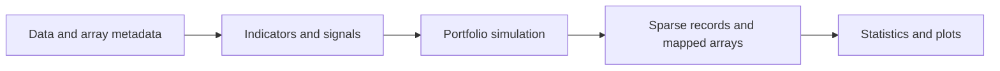
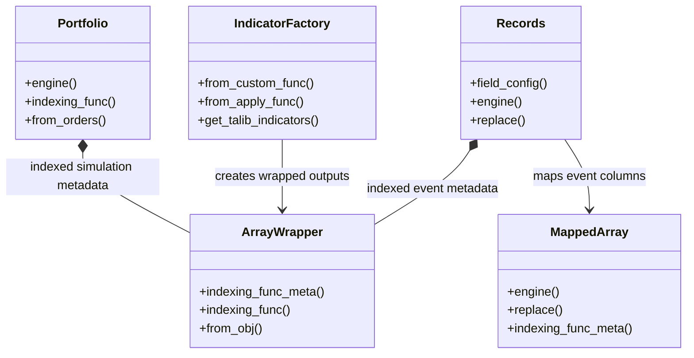
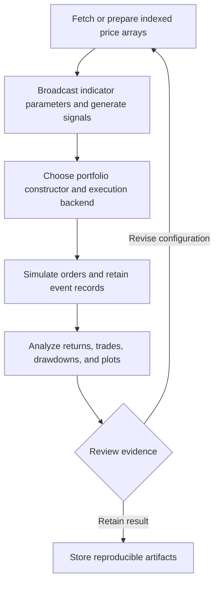
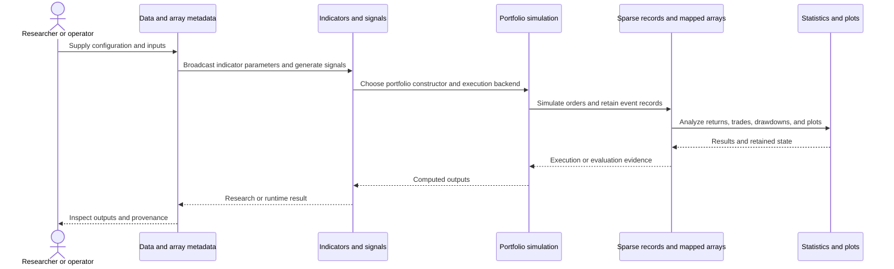
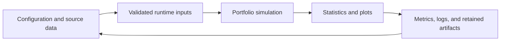
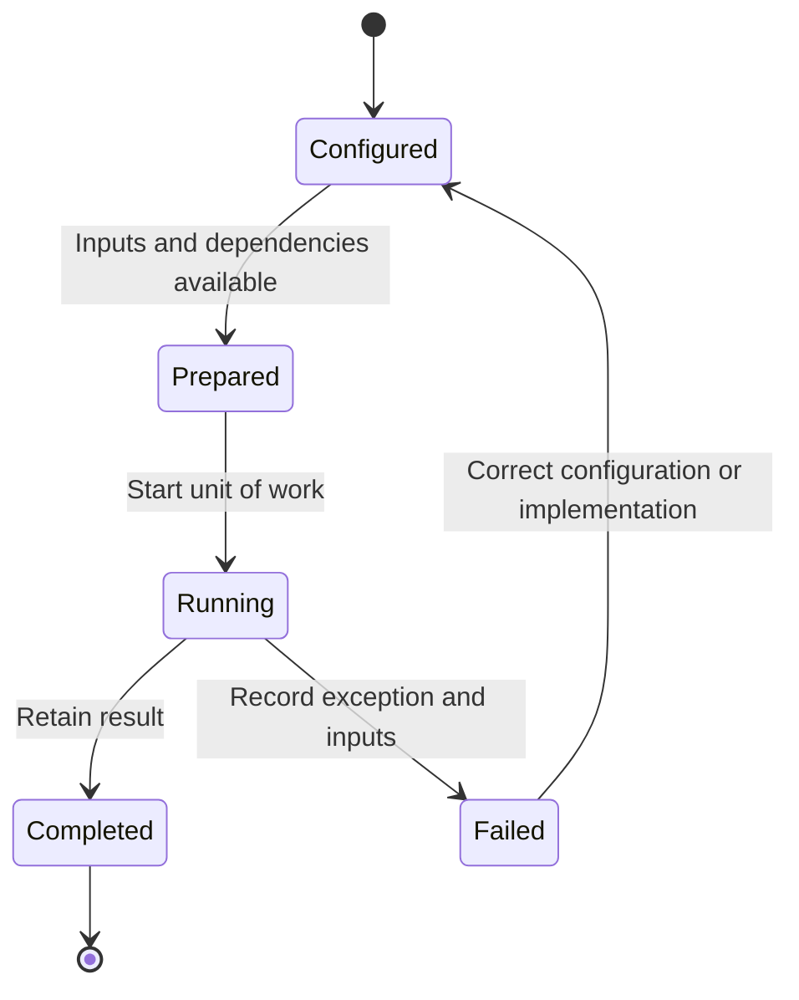

# VectorBT: workflow and architecture

Updated 2026-10-12. Source baseline: `0a6e1a134b5124600e4e367f8dd3a7233d15bab5` on `feature/ayu_develop`. See [development commands](development.md) and [validation evidence](validation.md) for the tested environment and current limitations.

## Purpose and features

Runs array-oriented strategy research by broadcasting prices and parameters into indicator, signal, portfolio-simulation, and record-analysis pipelines.

- IndicatorFactory and SignalFactory
- Order, signal, and custom callback simulations
- Column grouping and parameter broadcasting
- Sparse orders, trades, and drawdown records
- Numba execution and a local Rust companion

## Component architecture

ArrayWrapper preserves index, columns, and grouping metadata across NumPy computations. Portfolio constructors express different simulation contracts: orders, signals, or a callback-driven order function. Numba kernels handle numerical loops and return sparse event records. Records and MappedArray support analysis without expanding every event into a dense per-bar table. Broadcasting is a research convenience, but the simulation still needs explicit cash, fees, order sizing, and grouping semantics.

The diagram shows responsibility boundaries in the main research or execution path. Concrete entry points and implementation files are linked below.

## Core types

The types below belong to the public or native boundary described by the linked implementation. Arrows describe the dependency or ownership relationship used in the documented workflow. Listed Python methods are present in the linked source; native array types represent the binding boundary.

## End-to-end workflow

1. Fetch or prepare indexed price arrays.
2. Broadcast indicator parameters and generate signals.
3. Choose portfolio constructor and execution backend.
4. Simulate orders and retain event records.
5. Analyze returns, trades, drawdowns, and plots.

## Interaction sequence

The sequence follows one unit of work. Results return across the same boundaries that accepted the configuration and data. External I/O and numerical execution have different failure modes and should retain separate evidence.

## Data and artifact lifecycle

Inputs include explicit strategy or model settings, data selection, and execution assumptions. Retaining these with outputs makes a rerun reviewable. Temporary environments and caches remain development artifacts, while source-controlled configuration documents intended behavior.

## Execution and failure boundaries

Data provider integrations are optional external services. Their API versions can affect import and network tests. The rust/ project supplies the matching vectorbt-rust package through a uv path source. A Python wheel and a Rust extension build are separate artifacts and both are recorded in validation.

This state diagram describes the documented workflow, not a claim that these names are an implementation enum. Failure evidence should identify whether input preparation, external services, native compilation, or application execution failed.

## Development layout

Python code remains under src/vectorbt with Hatchling packaging. Tests import from src. The native companion remains in rust/ with its maturin backend and Cargo manifest.

## Source map

| Existing source | Responsibility evidence |
|---|---|
| [src/vectorbt/base/array_wrapper.py](../src/vectorbt/base/array_wrapper.py#L109) | Implementation and module/type documentation, beginning at line 109 |
| [src/vectorbt/base/reshape_fns.py](../src/vectorbt/base/reshape_fns.py#L40) | Implementation and module/type documentation, beginning at line 40 |
| [src/vectorbt/indicators/factory.py](../src/vectorbt/indicators/factory.py#L1206) | Implementation and module/type documentation, beginning at line 1206 |
| [src/vectorbt/indicators/basic.py](../src/vectorbt/indicators/basic.py#L93) | Implementation and module/type documentation, beginning at line 93 |
| [src/vectorbt/signals/factory.py](../src/vectorbt/signals/factory.py#L30) | Implementation and module/type documentation, beginning at line 30 |
| [src/vectorbt/signals/nb.py](../src/vectorbt/signals/nb.py#L42) | Implementation and module/type documentation, beginning at line 42 |
| [src/vectorbt/portfolio/base.py](../src/vectorbt/portfolio/base.py#L1500) | Implementation and module/type documentation, beginning at line 1500 |
| [src/vectorbt/portfolio/nb.py](../src/vectorbt/portfolio/nb.py#L66) | Implementation and module/type documentation, beginning at line 66 |
| [src/vectorbt/records/base.py](../src/vectorbt/records/base.py#L417) | Implementation and module/type documentation, beginning at line 417 |
| [src/vectorbt/records/mapped_array.py](../src/vectorbt/records/mapped_array.py#L379) | Implementation and module/type documentation, beginning at line 379 |
| [src/vectorbt/data/custom.py](../src/vectorbt/data/custom.py#L38) | Implementation and module/type documentation, beginning at line 38 |
| [src/vectorbt/_engine.py](../src/vectorbt/_engine.py#L19) | Implementation and module/type documentation, beginning at line 19 |
| [rust/Cargo.toml](../rust/Cargo.toml#L1) | Implementation and module/type documentation, beginning at line 1 |

The links target files present in this checkout. Follow their imports and adjacent tests when changing a boundary. The validation document distinguishes successful builds, complete test runs, inherited skips, and unresolved prerequisites.
